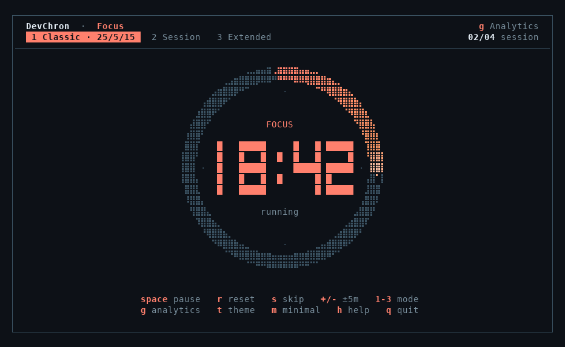
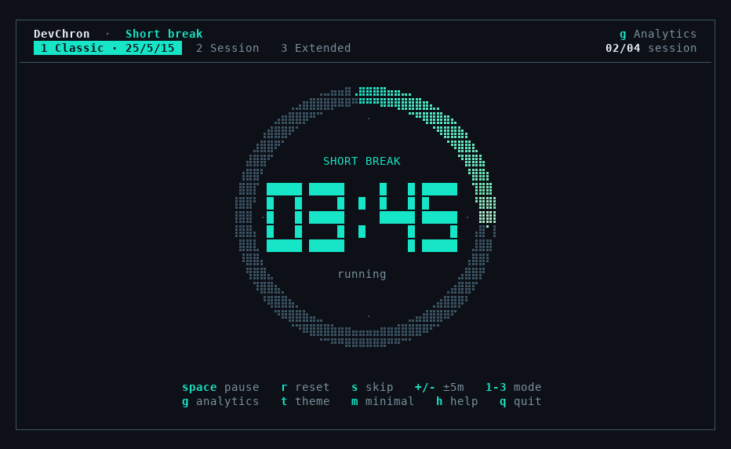
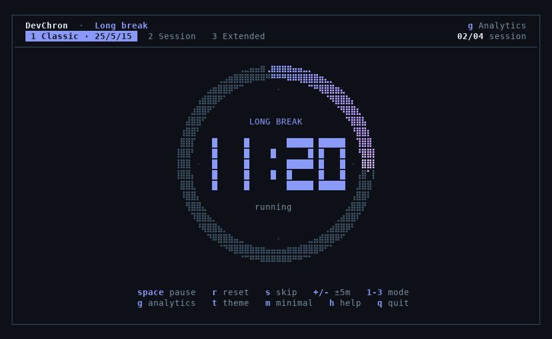
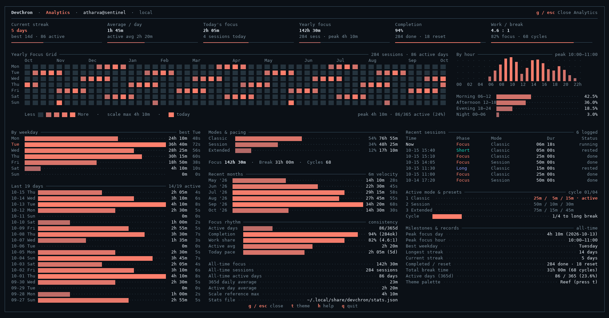

# DevChron

A fast, calm Pomodoro timer for your terminal. Built with Rust and
[ratatui](https://ratatui.rs), made for Hyprland/Wayland, and happy anywhere
else a truecolor terminal runs.






## Highlights

- **A ring you can read from across the room.** A smooth perceptual-gradient
  Braille ring with subtle cardinal dial ticks and a highlighted leading edge
  fills as the phase runs, with crisp block digits inside a single rounded
  frame.
- **Calm, focused offline Analytics.** Press `G` (or `D`) to open the dedicated
  Analytics view: a 365-day focus grid with a perceptual theme-derived colour
  ramp and today marker, headline metrics, 24-hour & time-of-day distribution,
  weekday rhythm, mode pacing, and a chronological recent-sessions log—100%
  offline.
- **Three modes.** Classic 25/5/15, Session 50/10/30, Extended 75/15/45.
  Switch with `1` `2` `3` or `Tab`.
- **A pleasant alarm.** A soft four-note bell chime rings at 00:00 and repeats
  until you press `A`. It is built into the binary, so there is nothing to
  download.
- **Six colour themes.** Each has its own three-colour palette and derived
  perceptual heatmap ramp, using foreground colours only so terminal
  transparency and Hyprland blur work naturally. Press `T` to cycle.
- **Honest timing.** The countdown is computed from the system clock, so
  frame hiccups or a suspended laptop can't make it drift, and the main loop
  redraws only when the displayed second changes (~0% idle CPU).
- **Stays out of your way.** Minimal mode, desktop notifications, offline
  historical stats, and a status file for Waybar and friends.

## Install

### Arch Linux (AUR)

```bash
yay -S devchron
```

### From this source tree (no root needed)

```bash
./scripts/install.sh              # builds, then installs to ~/.local
./scripts/install.sh --uninstall  # removes what it installed
```

This installs `~/.local/bin/devchron`, an app-launcher entry that opens
DevChron in a Kitty window, and an icon. Make sure `~/.local/bin` is on your
`PATH`.

### With Cargo (Linux & macOS)

```bash
git clone https://github.com/bhood239/DevChron.git
cd DevChron
cargo install --path .
```

### Requirements

| Needed for | Package / tool |
|---|---|
| Building | Rust 1.85 or newer recommended (the lockfile needs Cargo 1.78+) |
| Desktop notifications | A notification daemon (mako, dunst, swaync on Linux; native Notification Center on macOS) |
| Alarm sound | Any one of `paplay` (libpulse), `pw-play` (pipewire), `aplay` (alsa-utils) on Linux, or `afplay` (built-in on macOS) |
| Display | A truecolor terminal with a font that has Braille glyphs (Kitty, Foot, WezTerm, Alacritty, Ghostty, iTerm2 and most monospace fonts are fine) |

Without a sound player the alarm falls back to the terminal bell.

## Usage

```bash
devchron
```

Press `Space` to start. When a phase hits 00:00 the alarm rings; press `A` to
silence it and move on to the next phase, which waits for you to start it.
Press `G` at any time to open or close the Analytics view.

### Keys

| Key | Action |
|---|---|
| `Space` / `P` | Start / pause |
| `R` | Reset the current phase |
| `S` | Skip to the next phase |
| `A` | Stop the alarm (only active while it rings) |
| `G` / `D` | Open / close the Analytics page |
| `1` `2` `3` | Pick a mode |
| `Tab` | Next mode |
| `Y` / `Enter`, `N` / `Esc` | Confirm / cancel a mode switch |
| `+` / `-` | Add / remove 5 minutes |
| `T` | Next colour theme |
| `M` | Minimal mode |
| `H` / `?` | Help (any key closes it) |
| `Q` / `Esc` | Quit (`Esc` closes Analytics/dialogs first) |

### Modes

| Key | Mode | Focus | Short break | Long break |
|---|---|---|---|---|
| `1` | Classic (default) | 25 min | 5 min | 15 min |
| `2` | Session | 50 min | 10 min | 30 min |
| `3` | Extended | 75 min | 15 min | 45 min |

Switching while the timer is idle is instant. If a phase is running, or paused
part-way through, DevChron asks first. Confirming restarts the *same kind* of
phase at the new mode's length (paused) and keeps your place in the cycle.

Modes live in one table, `MODES` in `src/timer/mode.rs`. To add one, add a line
such as `PomodoroMode::new("Sprint", 15, 3, 10)`. The tabs, help screen and
number keys pick it up automatically (up to 9 modes).

### Minimal mode

`M` hides everything except the ring, the countdown and one line of text.

## The alarm

When a focus session or a break reaches 00:00:

- the timer holds at 00:00 and the ring and digits flash,
- a bell chime plays, repeating every three seconds,
- a desktop notification is sent.

Press `A` and the chime stops at once. The timer then moves to the next phase,
paused and ready. While the alarm rings only `A`, `G`, `T`, `M`, `H` and `Q` do
anything, so a stray keypress can't skip or restart the finished phase.

The chime is played by `paplay`, `pw-play`, `aplay` or `afplay` (whichever
works first). It is played by a single process at a time, which DevChron stops
the moment you dismiss the alarm or quit. You can turn the whole thing off in
the config.

## Themes

Six themes, each built on its own trio of colours (focus / short break /
long break) rather than variations of one palette. They are tuned for dark
terminal backgrounds and use foreground colours only.

| Theme | Focus | Short break | Long break | Mood |
|---|---|---|---|---|
| `reef` (default) | `#FF806D` coral | `#17E5C7` aqua | `#899AF8` periwinkle | Bright lagoon |
| `daybreak` | `#FFC53D` gold | `#79D8FF` sky | `#EE7AB2` rose | Sunny morning |
| `meadow` | `#3ABC65` leaf green | `#B9A6FF` wisteria | `#EA865D` apricot | Fresh air |
| `tropic` | `#01B8C2` teal | `#FF9EBB` flamingo | `#B4DC4B` lime | Fruit stand |
| `harbor` | `#5A8DFF` cobalt | `#FFBF90` peach | `#06B687` emerald | Sea at dusk |
| `sorbet` | `#F37AD8` orchid | `#AFD97A` pistachio | `#10AFD1` cyan | Sweet and cool |

Press `T` to cycle, or set `theme` in the config. Unknown names (including the
old `nord`, `catppuccin`, `classic`, `gruvbox`, `dracula` and `tokyo-night`)
fall back to `reef`.

## Configuration

DevChron reads `~/.config/devchron/config.toml` and creates it on first run.
Every key is optional.

```toml
[timer]
focus_duration = 25             # minutes (Classic mode)
short_break_duration = 5        # minutes (Classic mode)
long_break_duration = 15        # minutes (Classic mode)
cycles_before_long_break = 4    # applies to every mode

[notifications]
enabled = true                  # desktop notification at the end of each phase

[alarm]
enabled = true                  # bell chime at 00:00 until stopped with A

[ui]
theme = "reef"                  # reef, daybreak, meadow, tropic, harbor, sorbet

[integrations]
hyprland_status_bar = true      # write ~/.cache/devchron/status.json
```

The `[timer]` values define **Classic**; Session and Extended are fixed.

## Status bar integration

While running, DevChron keeps `~/.cache/devchron/status.json` up to date
(rewritten only when something changes) and removes it on exit:

```json
{
  "phase": "focus",
  "time_remaining": "23:45",
  "session": "2/4",
  "is_running": true,
  "percentage_complete": 7,
  "mode": "classic",
  "alarm_ringing": false
}
```

`phase` is `focus`, `short_break` or `long_break`. A ready-made Waybar script
is in [`assets/waybar-devchron.sh`](assets/waybar-devchron.sh) (needs `jq`):

```bash
mkdir -p ~/.config/waybar/scripts
cp assets/waybar-devchron.sh ~/.config/waybar/scripts/devchron.sh
chmod +x ~/.config/waybar/scripts/devchron.sh
```

```json
"custom/devchron": {
    "exec": "~/.config/waybar/scripts/devchron.sh",
    "return-type": "json",
    "interval": 1
}
```

## Files DevChron uses

| Path | Purpose |
|---|---|
| `~/.config/devchron/config.toml` | Settings |
| `~/.local/share/devchron/stats.json` | Offline daily and historical focus stats for the Analytics page |
| `~/.cache/devchron/status.json` | Live status for status bars |
| `~/.cache/devchron/alarm-chime.wav` | Copy of the built-in chime for the sound player |

## Building, testing and visual preview

```bash
cargo build --release     # binary at target/release/devchron
cargo test                # timer logic, alarm, analytics, themes, keys and rendering
cargo clippy
```

To dump a truecolor ANSI preview to your terminal and write a full HTML visual
gallery (`target/visual_preview.html`) across all 6 themes, 6 screens, and 5
terminal sizes (`60×16` through `160×50`):

```bash
cargo test -- --ignored --nocapture visual_preview_gallery
```

Tests never touch your real stats file, send notifications or play sound.

## Project layout

```
src/
  main.rs            event loop
  app.rs             state and key routing
  alarm.rs           the 00:00 alarm and chime playback
  timer/             clock-driven countdown, modes, historical stats & offline system identity
  ui/                timer & analytics rendering, shared style tokens, ring, themes
  events/            key bindings
  notification/      desktop notifications
  hyprland/          status.json writer
assets/              icon, desktop entry, chime.wav, Waybar script, screenshots
```

## License

MIT. See [LICENSE](LICENSE).
