# DevChron

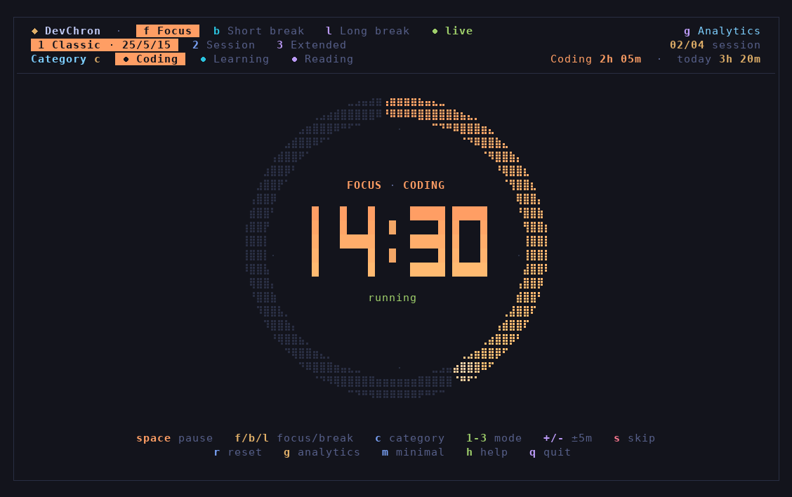

**DevChron** is a high-craft terminal Pomodoro timer and 100% offline focus analytics suite written in Rust with [ratatui](https://ratatui.rs). Designed around a unified **TokyoNight** semantic color system, it pairs a perceptual-gradient Braille progress ring and 5×5 block digits with structured multi-cycle focus modes, category-aware telemetry, animated full-cycle rewards, safe mode-switch protection, a built-in polyphonic chime alarm, and native Hyprland/Waybar status integration.

## Visual Feature Tour

### 1. Timer & Per-Category Focus Gradients

DevChron tracks your work across three first-class focus categories—**Coding** (`#FF9E64` warm orange), **Learning** (`#2AC3DE` bright cyan), and **Reading** (`#BB9AF7` violet)—and three structured Pomodoro modes (**Classic**, **Session**, and **Extended**). Switching categories with `C` (or `Shift+Tab`) immediately updates the Braille ring gradient, 5×5 block digits, header chip, and live category telemetry in the top-right corner.

| Coding (`Classic · 25/5/15`)                                   | Learning (`Session · 50/10/30`)                                    | Reading (`Extended · 75/15/45`)                                   |
| -------------------------------------------------------------- | ------------------------------------------------------------------ | ----------------------------------------------------------------- |
|  | 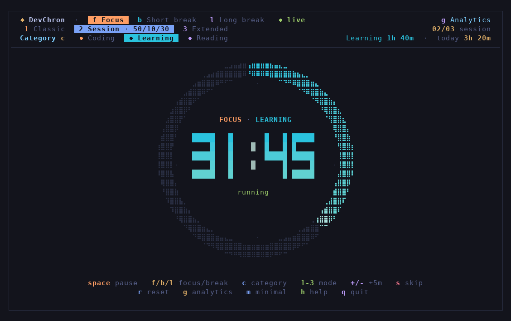 | 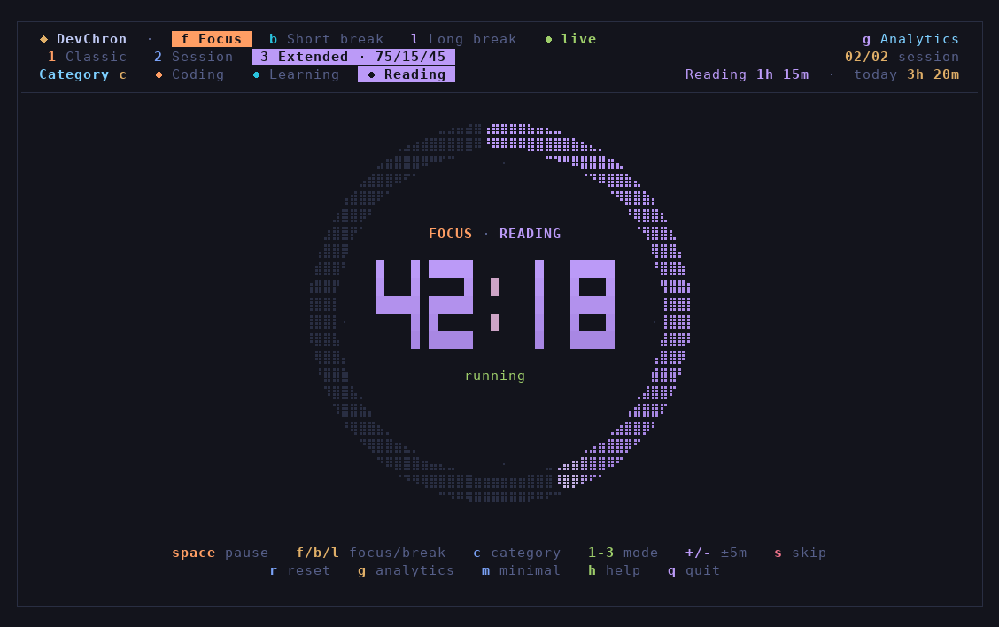 |

### 2. Short Breaks & Final Long Breaks

You can let phases progress naturally through your active mode's schedule or jump directly between **Focus** (`F`), **Short break** (`B`), and **Long break** (`L`) at any time. Each break phase renders with its own dedicated TokyoNight gradient so you can tell at a glance from across the room whether you are in a focus block, a short breather, or a final long recovery break.

| Short Break (`B`)                                 | Final Long Break (`L`)                                |
| ------------------------------------------------- | ----------------------------------------------------- |
| 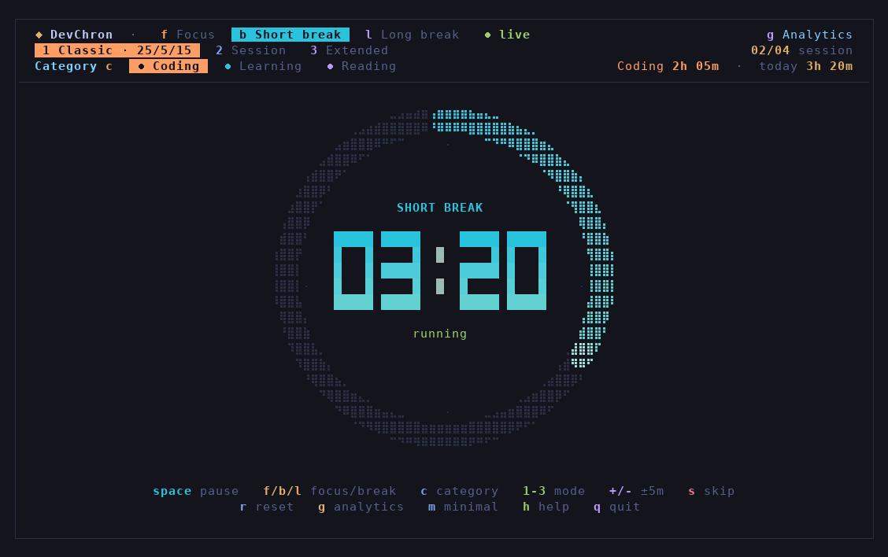 | 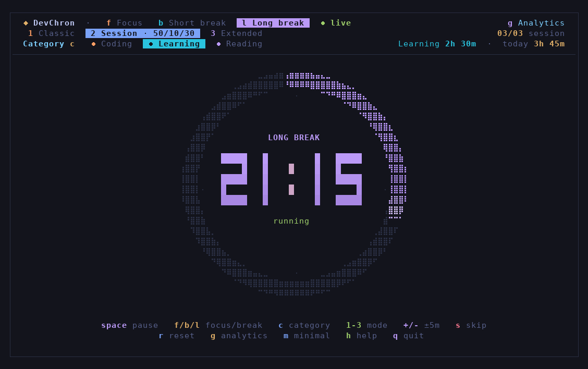 |

### 3. Animated Full-Cycle Reward Modal

Completing every focus cycle in your active mode (`4/4` in Classic, `3/3` in Session, or `2/2` in Extended) and silencing the `00:00` alarm with `A` unlocks the **Full-Cycle Reward** modal before your final long break begins.

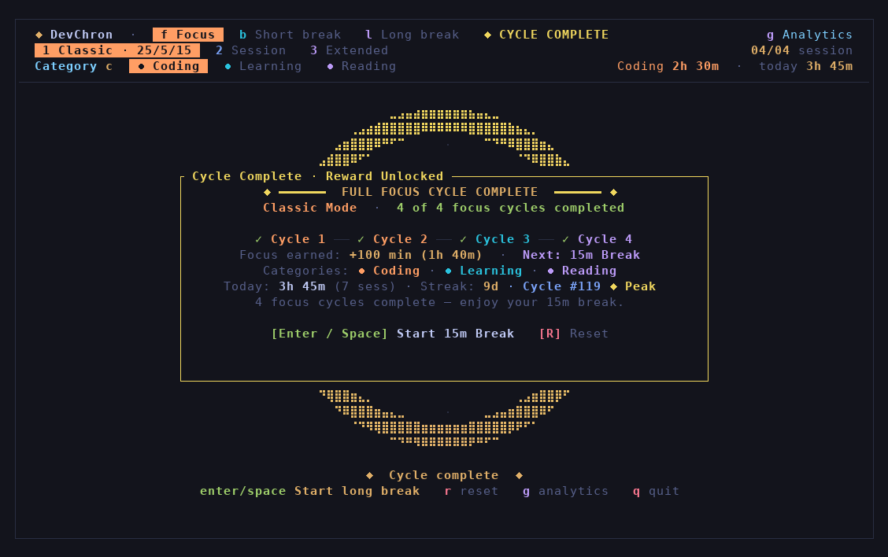

- **Immediate pre-break celebration:** Appears right after the final focus phase finishes and holds the transition into the final long break until you claim it.
- **Per-cycle category chain:** Renders each completed focus cycle node (`✓ Cycle 1 ── ✓ Cycle 2 ...`) in the exact category color worked on during that cycle.
- **Session & streak telemetry:** Displays total focus minutes earned (`+100 min` in Classic or `+150 min` in Session/Extended), the upcoming long break duration (`15m`, `30m`, or `45m`), all categories practiced in the sequence, today's cumulative focus, your active daily streak, all-time completed cycle count, and a `★ Peak` badge when you set a new daily record.
- **Protected modal state:** Press `Enter` or `Space` (or `Y`) to claim the reward and transition to the final long break (paused and ready to start), or `R` to reset to Focus 1. Stray timer keys (`S`, `F`, `B`, `L`, `+`, `-`, `C`) are blocked while the modal is open.

### 4. Safe Mode-Switch Confirmation Modal

Switching between **Classic**, **Session**, and **Extended** modes when the timer is idle at the start of Cycle 1 is instant. If you attempt to switch modes after completing one or more focus cycles in the current sequence—or while a timer is running, paused mid-phase, ringing, or awaiting reward acknowledgment—DevChron opens a confirmation dialog so an accidental keypress never silently wipes out your cycle progression.

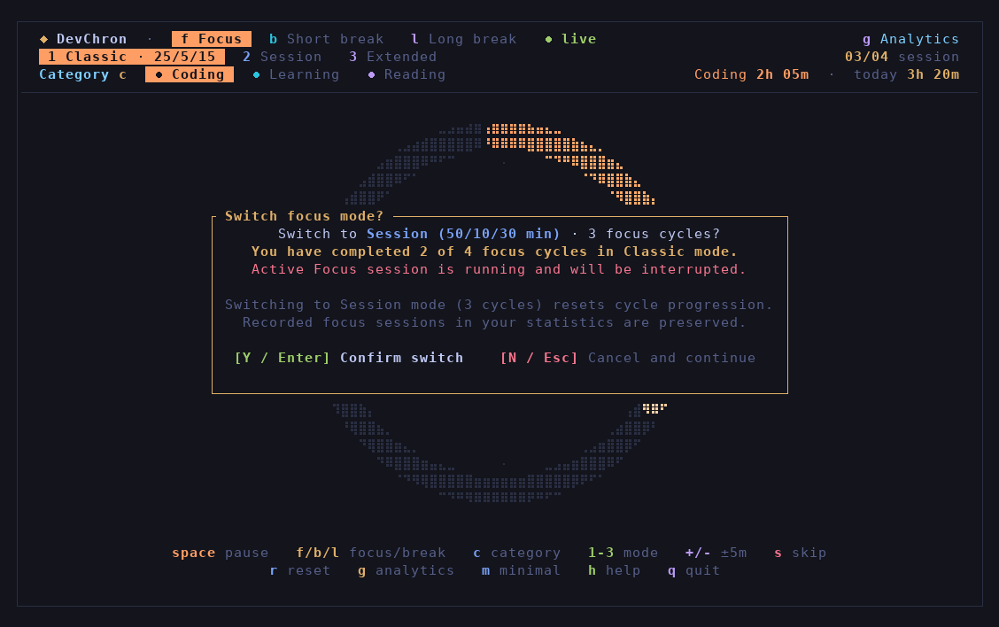

- **Explicit cycle progress report:** Shows how many focus cycles you have completed in the current mode (for example, `You have completed 2 of 4 focus cycles in Classic mode.`) and warns if an active or paused session will be interrupted.
- **Statistics preservation guarantee:** Confirms that switching modes only resets the unfinished in-memory cycle sequence while **all previously completed focus sessions in `stats.json` remain intact**.
- **Clear modal controls:** Press `Y` or `Enter` to confirm the switch (resetting cycle progression to `0` and loading the target mode's Focus 1 duration, paused), or `N` / `Esc` to cancel and resume your current sequence untouched.

### 5. Offline Analytics Dashboard (`G` / `D`)

Press `G` (or `D`) from anywhere to open the full-screen **Offline Analytics** dashboard. All telemetry is computed locally from `~/.local/share/devchron/stats.json` and your local OS identity (`user@hostname`) with zero network requests.

#### All-Categories Overview (`c` → `All`)

When **All** is selected in the Analytics header, the 365-day **Yearly Focus Grid** uses a unified contribution-green (`#39D353`) intensity ramp while every bar chart and telemetry table breaks down your hours across **Coding**, **Learning**, and **Reading** using proportional multi-color stacked bars.

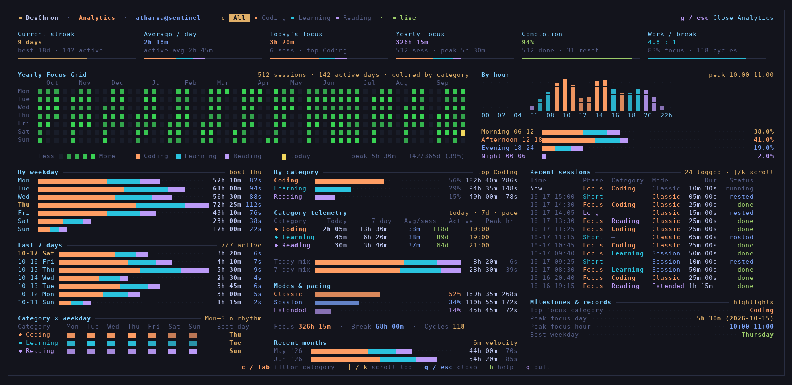

#### Interactive Category Filtering (`C` / `Tab`)

Press `C` or `Tab` inside Analytics to filter the entire dashboard by **Coding**, **Learning**, or **Reading**. The 365-day **Yearly Focus Grid**, intensity legend, 24-hour distribution, chronotype bars, weekday bars, 7-day history, and **Recent sessions** flight log dynamically switch to that category's TokyoNight color ramp—while **Today** always retains its independent solar-yellow (`#F0D75E`) marker.

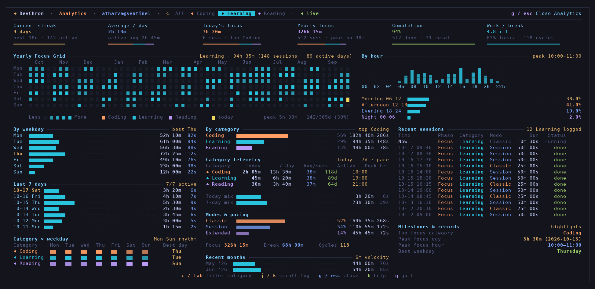

- **6 Multi-Hue Hero Cards:** Instant readout of **Current streak** (with all-time best and active days), **Average / day** (with active-day average and 3-color category under-bar), **Today's focus** (with session count, top category, and 3-color under-bar), **Yearly focus** (with total sessions and peak day), **Completion** rate (`done` vs `reset`), and **Work / break** ratio (with focus share % and completed full cycles).
- **53-Week × 7-Day Yearly Focus Grid:** Full 365-day rolling calendar aligned Monday through Sunday with month headers, perceptual linear-light color scaling, category swatches, and a solar-yellow `today` indicator.
- **24-Hour Diurnal Rhythm & Chronotype Split:** Vertical sparkline histogram across `00h–23h` colored by each hour's dominant category, paired with stacked category bars for **Morning 06–12**, **Afternoon 12–18**, **Evening 18–24**, and **Night 00–06**.
- **Weekday Rhythm, Last 7 Days & Category × Weekday Matrix:** Stacked category bars for Monday–Sunday and the last 7 calendar days, plus a dedicated **Category × weekday** heatmap matrix highlighting each category's strongest day of the week.
- **Category Telemetry, Modes & Pacing & 6-Month Velocity:** Per-category breakdown (`Share %`, `Total time`, `Sessions`), detailed **Category telemetry** table (`Today`, `7-day`, `Avg/sess`, `Active` days, `Peak hr`, plus `Today mix` and `7-day mix` stacked bars), **Modes & pacing** across `Classic`, `Session`, and `Extended`, and 6-month velocity bars.
- **Scrollable Recent Sessions Log & Milestones:** Chronological audit trail (`Time`, `Phase`, `Category`, `Mode`, `Dur`, `Status`) scrollable with `J` / `K` (or `↑` / `↓`), plus all-time **Milestones & records**.

### 6. Built-In `00:00` Alarm, Minimal Mode & Help Overlay

When any focus or break phase reaches `00:00`, DevChron holds at `00:00`, flashes the ring and digits between gold and rose, sends a desktop notification, and plays its built-in four-note polyphonic bell chime every 3 seconds until you press `A`.

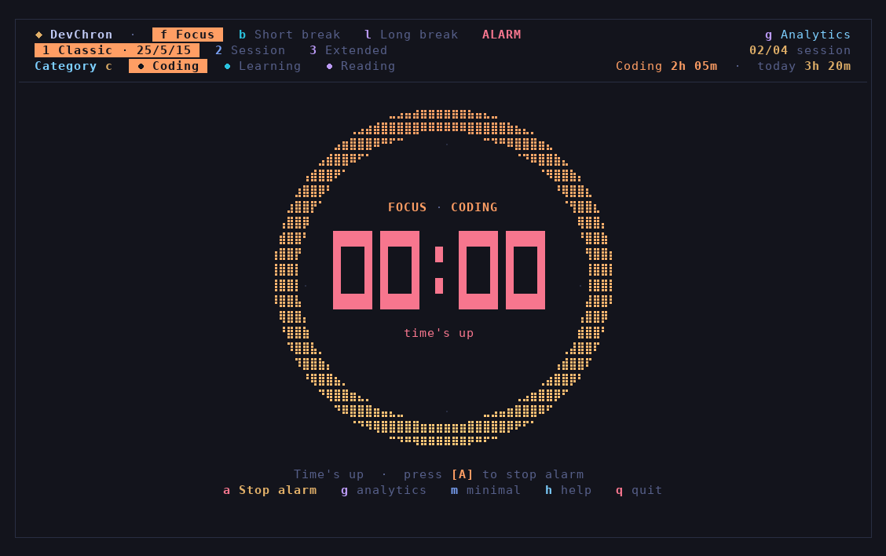

Need zero chrome while working, or a quick reminder of keybindings? Toggle **Minimal Mode** with `M` or open the **Keyboard Shortcuts** screen with `H` / `?`:

| Minimal Mode (`M`)                       | Keyboard Shortcuts (`H` / `?`)                            |
| ---------------------------------------- | --------------------------------------------------------- |
| 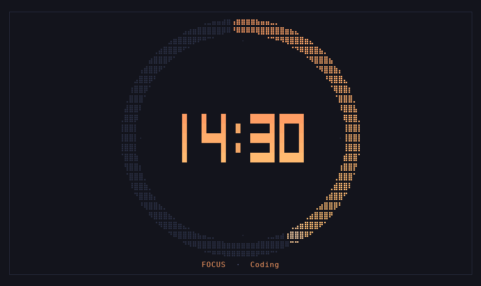 | 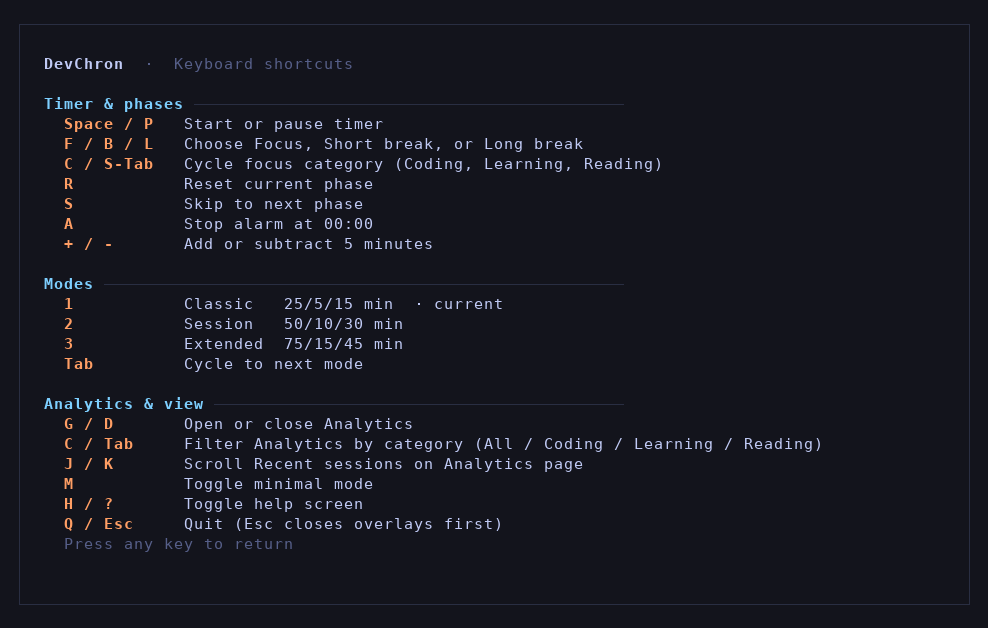 |

## Focus Modes & Authoritative Cycle Schedules

All modes are defined in a single authoritative table (`MODES` in `src/timer/mode.rs`). Each mode specifies its focus duration, short-break duration, final long-break duration, and required number of completed focus cycles:

| Key | Mode                  | Focus Cycles | Focus Duration | Short Breaks | Final Long Break | Total Focus Time     |
| --- | --------------------- | ------------ | -------------- | ------------ | ---------------- | -------------------- |
| `1` | **Classic** (default) | **4 cycles** | 25 min         | 5 min (×3)   | 15 min           | **100 min** (1h 40m) |
| `2` | **Session**           | **3 cycles** | 50 min         | 10 min (×2)  | 30 min           | **150 min** (2h 30m) |
| `3` | **Extended**          | **2 cycles** | 75 min         | 15 min (×1)  | 45 min           | **150 min** (2h 30m) |

### Exact Phase Sequences

- **Classic Mode (4 focus cycles · 100 minutes total focus):**
  `25m Focus 1` → `5m Short Break 1` → `25m Focus 2` → `5m Short Break 2` → `25m Focus 3` → `5m Short Break 3` → `25m Focus 4` → **Full-Cycle Reward** → `15m Final Long Break`
- **Session Mode (3 focus cycles · 150 minutes total focus):**
  `50m Focus 1` → `10m Short Break 1` → `50m Focus 2` → `10m Short Break 2` → `50m Focus 3` → **Full-Cycle Reward** → `30m Final Long Break`
- **Extended Mode (2 focus cycles · 150 minutes total focus):**
  `75m Focus 1` → `15m Short Break 1` → `75m Focus 2` → **Full-Cycle Reward** → `45m Final Long Break`

### Cycle Progression Rules

- **Strict completion accounting:** A focus cycle increments only when a `Focus` phase runs all the way down to `00:00`. Short breaks never count as focus cycles.
- **No false rewards on skip or reset:** Skipping (`S`), resetting (`R`), or manually switching phases (`F` / `B` / `L`) mid-session never increments the completed focus-cycle counter or triggers a full-cycle reward.
- **Clean sequence wrap-around:** Once you acknowledge the Full-Cycle Reward (`Enter` / `Space`) and complete or skip the **Final Long Break**, the cycle counter resets to `0` so your next sequence begins cleanly at **Focus 1**.

## TokyoNight Semantic Color System

DevChron uses foreground colors exclusively (no opaque background fills) so terminal transparency and Hyprland blur work out of the box. Every color in `src/ui/theme.rs` has a dedicated semantic role:

| Semantic Role                | Description                                         | Hex       |
| ---------------------------- | --------------------------------------------------- | --------- |
| **Coding** (`Focus` default) | Warm orange primary accent & gradient start         | `#FF9E64` |
| **Coding Gradient End**      | Warm amber-gold ring & digit gradient end           | `#FFC777` |
| **Learning** (`Short break`) | Bright cyan accent & gradient start                 | `#2AC3DE` |
| **Learning Gradient End**    | Mint-aqua ring & digit gradient end                 | `#73DACA` |
| **Reading** (`Long break`)   | Vivid violet accent & gradient start                | `#BB9AF7` |
| **Reading Gradient End**     | Deep lavender ring & digit gradient end             | `#9D7CD8` |
| **All-Category Yearly Grid** | Contribution-green heatmap ramp (`All` view)        | `#39D353` |
| **Today Marker**             | Solar yellow cell highlight (independent of filter) | `#F0D75E` |
| **Gold / Streaks / Records** | Trophy gold for streaks, peaks, and callouts        | `#E0AF68` |
| **Emerald / Completion**     | Soft green for completed sessions and live badge    | `#9ECE6A` |
| **Sky / Information**        | TokyoNight blue for Session mode & averages         | `#7AA2F7` |
| **Section Headings**         | Ice blue for section headers and Analytics link     | `#7DCFFF` |
| **Reset / Alarm / Warning**  | Signal rose-pink for `00:00` alarm & resets         | `#F7768E` |
| **Primary Text**             | Cool lavender-white body & value typography         | `#C0CAF5` |
| **Muted Labels / Paused**    | Slate-blue for secondary labels & paused state      | `#565F89` |
| **Frames & Dividers**        | Deep navy-slate for single rounded outer frame      | `#292E42` |

## Installation

Choose the installation method that best fits your system.

### 1. Arch Linux (Pre-built Package)

You can install the pre-compiled package directly from the [GitHub Releases](https://github.com/Atharvapawar007/DevChron/releases) without compiling from source:

```bash
# Install directly via pacman
sudo pacman -U https://github.com/Atharvapawar007/DevChron/releases/download/v0.1.1/devchron-plus-0.1.1-1-x86_64.pkg.tar.zst
```

Or, if you downloaded the package file locally:

```bash
sudo pacman -U devchron-plus-0.1.1-1-x86_64.pkg.tar.zst
```

### 2. Arch Linux (AUR)

If you use an AUR helper like `yay` or `paru`:

```bash
yay -S devchron-plus
# or
paru -S devchron-plus
```

To build and install manually with `makepkg`:

```bash
git clone https://github.com/Atharvapawar007/DevChron.git
cd DevChron
makepkg -si
```

### 3. Build from Source (Any Linux / macOS)

Clone the repository and run the bundled installer script:

```bash
git clone https://github.com/Atharvapawar007/DevChron.git
cd DevChron
./scripts/install.sh
```

`./scripts/install.sh` builds the release binary (`cargo build --release --locked`) and sets up:

- `~/.local/bin/devchron`: executable binary (make sure `~/.local/bin` is on your `$PATH`)
- `~/.local/share/applications/devchron.desktop`: desktop launcher entry
- `~/.local/share/icons/hicolor/scalable/apps/devchron.svg`: scalable vector icon

Alternatively, you can install directly with Cargo:

```bash
cargo install --path . --locked
```

## Uninstallation

**Arch Linux package (pacman / AUR):**

```bash
sudo pacman -Rns devchron-plus
```

**Script installer:**

```bash
./scripts/install.sh --uninstall
```

> **Note:** Uninstalling removes the binaries and desktop shortcuts while preserving your user settings (`~/.config/devchron`) and focus history (`~/.local/share/devchron/stats.json`).

## Requirements

| Component                | Requirement                                                                                                                                               |
| ------------------------ | --------------------------------------------------------------------------------------------------------------------------------------------------------- |
| Operating System         | Linux (native Hyprland/Wayland/X11 support) or macOS                                                                                                      |
| Compiler (source builds) | Rust & Cargo (1.78+ required, 1.85+ recommended)                                                                                                          |
| Terminal                 | Any truecolor terminal with Braille glyph support (kitty, foot, wezterm, alacritty, ghostty, iTerm2)                                                      |
| Alarm Audio              | Any one of `pw-play` (PipeWire), `paplay` (PulseAudio), `aplay` (ALSA) on Linux, or `afplay` on macOS (falls back to terminal bell if none are installed) |
| Notifications            | Desktop notification daemon (swaync, mako, dunst on Linux; native Notification Center on macOS)                                                           |

## Keyboard Shortcuts

```bash
devchron
```

| Key                        | Context        | Action                                                                                      |
| -------------------------- | -------------- | ------------------------------------------------------------------------------------------- |
| `Space` / `P`              | Timer          | Start or pause the current timer phase                                                      |
| `Enter` / `Space` / `Y`    | Reward Modal   | Claim the Full-Cycle Reward and transition to the Final Long Break                          |
| `F` / `B` / `L`            | Timer          | Switch directly to **Focus**, **Short break**, or **Long break**                            |
| `C` / `Shift+Tab`          | Timer          | Cycle active Focus category (`Coding` → `Learning` → `Reading`)                             |
| `1` / `2` / `3`            | Timer          | Select **Classic** (`25/5/15`), **Session** (`50/10/30`), or **Extended** (`75/15/45`) mode |
| `Tab`                      | Timer          | Cycle to the next Pomodoro mode (`Classic` → `Session` → `Extended`)                        |
| `Y` / `Enter`, `N` / `Esc` | Confirm Modal  | Confirm or cancel a mode/phase switch when progress exists                                  |
| `+` / `-`                  | Timer          | Add or subtract 5 minutes from the current phase                                            |
| `S`                        | Timer          | Skip to the next phase (does not count as a completed focus cycle)                          |
| `R`                        | Timer / Reward | Reset the current phase (or dismiss reward and reset to Focus 1)                            |
| `A`                        | Any View       | Stop the ringing `00:00` alarm and advance (or unlock the Full-Cycle Reward)                |
| `G` / `D`                  | Any View       | Open or close the offline **Analytics** dashboard                                           |
| `C` / `Tab`                | Analytics      | Cycle category filter (`All` → `Coding` → `Learning` → `Reading`)                           |
| `J` / `K` / `↑` / `↓`      | Analytics      | Scroll the **Recent sessions** flight log                                                   |
| `M`                        | Timer          | Toggle distraction-free **Minimal Mode**                                                    |
| `H` / `?`                  | Any View       | Open the **Keyboard Shortcuts** help screen (any key closes it)                             |
| `Q` / `Esc`                | Any View       | Quit DevChron (`Esc` closes Analytics, Help, or modal dialogs first)                        |

## Configuration

DevChron reads `~/.config/devchron/config.toml` and automatically generates it on first launch. Every setting is optional:

```toml
[timer]
focus_duration = 25             # minutes (Classic mode default: 25)
short_break_duration = 5        # minutes (Classic mode default: 5)
long_break_duration = 15        # minutes (Classic mode default: 15)
cycles_before_long_break = 4    # focus cycles in Classic mode (default: 4)

[notifications]
enabled = true                  # desktop notification when a phase reaches 00:00

[alarm]
enabled = true                  # four-note bell chime at 00:00 until stopped with A

[ui]
theme = "tokyonight"            # unified TokyoNight palette

[integrations]
hyprland_status_bar = true      # maintain live ~/.cache/devchron/status.json
```

The `[timer]` settings customize **Classic** mode; **Session** (`50/10/30`, 3 cycles) and **Extended** (`75/15/45`, 2 cycles) always follow their fixed schedules.

## Hyprland & Waybar Integration

When `hyprland_status_bar = true`, DevChron writes `~/.cache/devchron/status.json` whenever the timer state changes and removes it cleanly on exit:

```json
{
  "phase": "focus",
  "time_remaining": "14:30",
  "session": "2/4",
  "is_running": true,
  "percentage_complete": 42,
  "mode": "classic",
  "alarm_ringing": false
}
```

A ready-to-use Waybar script is included in `assets/waybar-devchron.sh` (requires `jq`):

```bash
mkdir -p ~/.config/waybar/scripts
cp assets/waybar-devchron.sh ~/.config/waybar/scripts/devchron.sh
chmod +x ~/.config/waybar/scripts/devchron.sh
```

Add the module to your `~/.config/waybar/config`:

```json
"custom/devchron": {
    "exec": "~/.config/waybar/scripts/devchron.sh",
    "return-type": "json",
    "interval": 1
}
```

## Files & Data Paths

| Path                                 | Purpose                                                                 |
| ------------------------------------ | ----------------------------------------------------------------------- |
| `~/.config/devchron/config.toml`     | User configuration file (created automatically on first run)            |
| `~/.local/share/devchron/stats.json` | Offline daily, hourly, per-category, and per-mode historical statistics |
| `~/.cache/devchron/status.json`      | Live JSON status output for Waybar and status bars                      |
| `~/.cache/devchron/alarm-chime.wav`  | Cached copy of the embedded four-note alarm chime                       |

## Project Architecture

```text
DevChron/
├── src/
│   ├── main.rs            # Terminal setup, clock-driven event loop & redraw scheduling
│   ├── app.rs             # Application state, modal routing, reward animation & actions
│   ├── alarm.rs           # Embedded 00:00 bell chime synthesis & audio player management
│   ├── config/            # TOML configuration loader & defaults
│   ├── events/            # Crossterm keyboard & terminal resize event handling
│   ├── hyprland/          # Live status.json writer for Waybar/Hyprland
│   ├── notification/      # Desktop notifications via notify-rust
│   ├── timer/
│   │   ├── mod.rs         # FocusCategory & timer module exports
│   │   ├── mode.rs        # Authoritative PomodoroMode definitions (Classic, Session, Extended)
│   │   ├── pomodoro.rs    # Multi-cycle state machine, CycleReward & mode-switch guards
│   │   ├── session.rs     # Offline SessionStats persistence, 365-day grid & category telemetry
│   │   └── state.rs       # Wall-clock countdown timer & phase primitives
│   └── ui/
│       ├── mod.rs         # UI module exports
│       ├── render.rs      # Full timer, reward/confirm modals, minimal, help & analytics views
│       ├── ring.rs        # Sub-cell 2×4 Braille circular progress ring with gradient & head glow
│       ├── style.rs       # Typography tokens, rounded frames, section headers & keycap bars
│       └── theme.rs       # TokyoNight semantic color palette & linear-light color blending
├── assets/                # Feature screenshots, Waybar script, desktop entry, SVG icon & chime
└── scripts/
    └── install.sh         # User-local build & installation script
```

## License

MIT License. See [LICENSE](LICENSE) for details.
